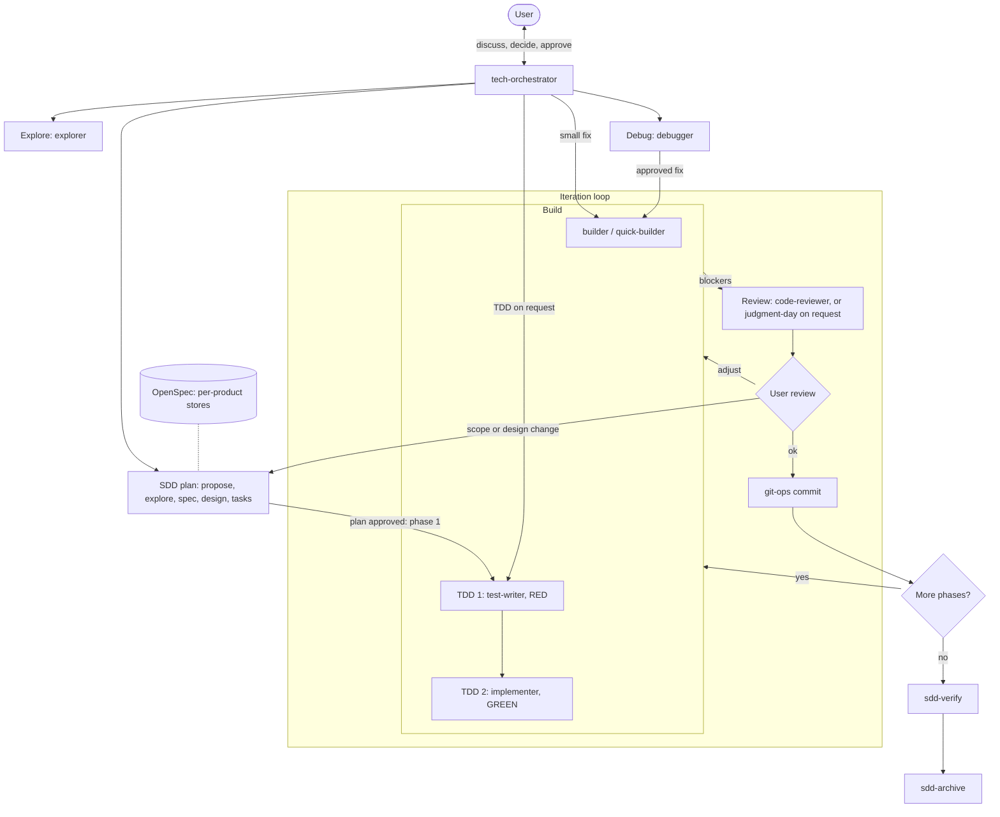

<div align="center">
    <h1 align="center">NUYTEK - HARNESS</h1>
    <p align="center">
        A control-first AI harness: agents delegate, humans approve.
    </p>
</div>

<br>
<br>

This is my personal AI harness. The goal is very high control over what the AI does. These are the tools I use daily, for all my projects and at work.

Fixed paths, tokens, model choices and similar values are here because they work for me. If you reuse this, adjust them to your own setup.

<br>

## Installation

Requirements: bash >= 4 and `claude`, `node`, `python3`, `jq`, `engram`, `codegraph`, `openspec` on `PATH`.

```bash
./scripts/nuytek-harness install
```

Run it in a terminal for an interactive menu. Actions:

- `install`: set up the harness
- `update`: apply repo changes
- `reinstall`: install from scratch
- `remove`: uninstall
- `clean-backups`: delete old snapshots
- `pull`: import local config into the repo

Every change takes a snapshot in `~/.claude-backups/`.

Available for: Claude Code.

Secrets and auth stay outside the repo (`GITHUB_TOKEN`, `ZENHUB_API_TOKEN`, `ZENHUB_WORKSPACE_ID`, Linear MCP auth).

<br>

## Overview



Not a one-shot system: I work with the orchestrator in a constant back-and-forth, and it never writes code itself — it delegates and asks before anything of consequence. Work moves in iterations: build, review, my review, adjust until it's right. When an iteration is good, git-ops commits it and we move to the next phase of the SDD plan; if an adjustment changes scope or design, the SDD artifacts are updated first. TDD, when worth it, is two separate steps: test-writer writes failing tests (RED), then implementer makes them pass (GREEN). Verify and archive happen once, when every phase is done.

### Agents

Reference: [agents/README.md](agents/README.md).

| Group | Agents |
|---|---|
| Orchestration | `tech-orchestrator`, `strategist` |
| Build / write | `builder`, `quick-builder` |
| TDD | `test-writer`, `implementer` |
| Review | `code-reviewer`, `judge-a`, `judge-b` |
| Investigation | `debugger`, `explorer` |
| SDD phases | `sdd-propose`, `sdd-explore`, `sdd-spec`, `sdd-design`, `sdd-tasks`, `sdd-verify`, `sdd-archive` |
| Git | `git-ops` |
| Maintenance / infra | `codegraph-ops`, `engram-ops`, `specter-ops`, `aws` |

### Skills

Loaded on demand.

| Group | Skills |
|---|---|
| Design | `senior-architect`, `software-design-patterns`, `refactoring-techniques`, `event-schema` |
| Quality | `karpathy-guidelines`, `judgment-day`, `md-style-guide` |
| Trackers / releases | `github-issue`, `github-pr`, `linear-issue`, `zenhub-issue`, `release-notes` |
| Session / docs | `context-compact`, `find-docs`, `skill-registry` |

### MCPs

Reference: [claude/mcp-servers.md](claude/mcp-servers.md).

| Server | Purpose |
|---|---|
| `engram` | Persistent memory |
| `codegraph` | Per-project symbol and call-graph index |
| `context7` | Current library docs |
| `github` | Issues, PRs, repo search |
| `linear-server` | Linear issues and projects |
| `zenhub` | ZenHub (optional, work) |
| `filesystem` | Filesystem access outside the project root |

### Commands

Custom slash commands.

| Command | Purpose |
|---|---|
| `/explore` | Read-only pre-check of a question |
| `/review` | Standards review of a scope |
| `/pr-review` | Draft PR review comments, never posts |
| `/clear-comments` | Audit noisy or stale comments |
| `/clear-tests` | Audit low-value or overlapping tests |
| `/codegraph` | Check or maintain CodeGraph indexes |
| `/memory` | Review or curate Engram memory |
| `/specter` | Manage OpenSpec stores, repos.yaml and spec health |

### Hooks

| Hook | Purpose |
|---|---|
| Bash guard | Per-agent Bash allow-list; only `git-ops` may stage, commit, push (push only when the user asks) or manage worktrees |
| Irreversible-action prompt hook | Flags destructive database and disk operations |
| Stop verify | On Stop, warns if tests or lint fail (never blocks) |
| `herdr` state | Reports session state to `herdr` |
| `codegraph prompt-hook` | CodeGraph context on each prompt |
| Notification sounds | Sound on agent completion and permission prompts |

Native `permissions` ask before deletes, git discards, stash, force push, worktree and branch deletes and CodeGraph maintenance.

### Plugins

Installed from marketplaces by the installer.

| Plugin | Purpose |
|---|---|
| `caveman` | Terse communication mode |
| `ponytail` | Simplest-working-code mode |
| `engram` | Memory MCP and hooks |
| `claude-hud` | Statusline |

### Memory

- **Engram**: persistent cross-session memory shared by the orchestrator and most subagents (decisions, bug fixes, conventions).
- **OpenSpec**: SDD artifacts (proposal, specs, design, tasks) in one store per product (repo-to-store map in `~/dev/specter/repos.yaml`, optional local git-ignored `openspec/config.yaml` pointer; stores are folders in the specs repo `~/dev/specter/`).
