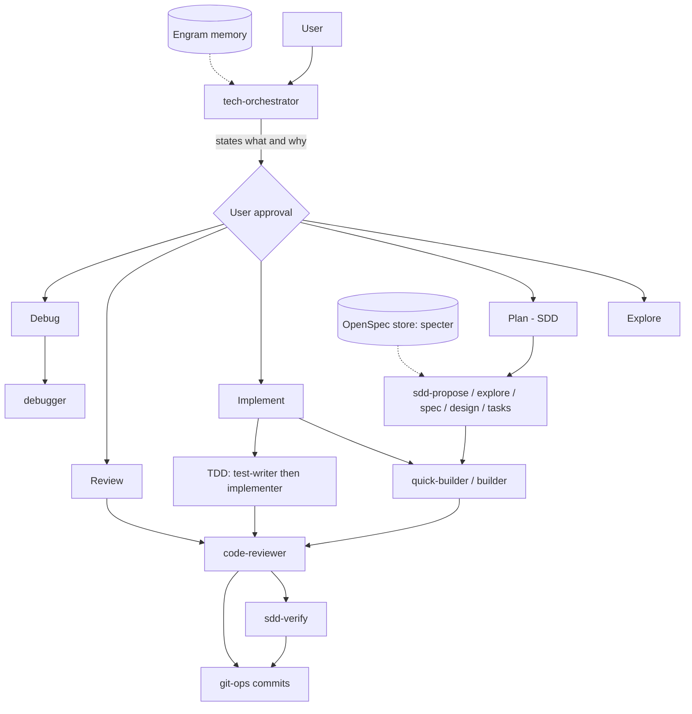

# abysal-harness

This is my personal AI harness (Andr3xDev). The goal is very high control over what the AI does. These are the tools I use daily, for all my projects and at work.

Fixed paths, tokens, model choices and similar values are here because they work for me. If you reuse this, adjust them to your own setup.

## Installation

Requirements: bash >= 4 and `claude`, `node`, `python3`, `jq`, `engram`, `codegraph`, `openspec` on `PATH`.

```bash
./scripts/nuytek-harness install
```

Run it with no arguments on a TTY for an interactive menu. Other actions: `update`, `reinstall`, `remove`, `clean-backups`, `pull` (import local config back into the repo). Every change takes a snapshot in `~/.claude-backups/`.

The installer is built to be extensible to more apps: each target lives in `scripts/targets/`. Currently only Claude Code (`scripts/targets/claude.sh`) is supported. OpenCode and Pi may come later.

Secrets and auth stay outside the repo (`GITHUB_TOKEN`, `ZENHUB_API_TOKEN`, `ZENHUB_WORKSPACE_ID`, Linear MCP auth).

## Overview



The orchestrator never writes code. It delegates, and the user approves anything of consequence.

### Agents

Defined in `agents/`.

| Group | Agents |
|---|---|
| Orchestration | `tech-orchestrator`, `strategist` |
| Build / write | `builder`, `quick-builder`, `explorer` |
| TDD | `test-writer`, `implementer` |
| Review | `code-reviewer`, `judge-a`, `judge-b` |
| Investigation | `debugger`, `explorer` |
| SDD phases | `sdd-propose`, `sdd-explore`, `sdd-spec`, `sdd-design`, `sdd-tasks`, `sdd-verify`, `sdd-archive` |
| Git | `git-ops` |
| Maintenance / infra | `codegraph-maintainer`, `engram-maintainer`, `aws` |
| Echor | `echor-onboarder`, `echor-updater`, `echor-consultador`, `echor-validator` |

### Skills

Defined in `skills/`, loaded on demand.

| Group | Skills |
|---|---|
| Design | `senior-architect`, `software-design-patterns`, `refactoring-techniques`, `event-schema` |
| Quality | `karpathy-guidelines`, `judgment-day`, `md-style-guide` |
| Trackers / releases | `github-issue`, `github-pr`, `linear-issue`, `zenhub-issue`, `release-notes` |
| Session / docs | `context-compact`, `find-docs`, `skill-registry`, `echor-vault` |

### MCPs

Configured in `claude/claude-mcp.json`, described in `claude/mcp-servers.md`.

| Server | Purpose |
|---|---|
| `engram` | Persistent memory |
| `codegraph` | Per-project symbol and call-graph index |
| `context7` | Current library docs |
| `github` | Issues, PRs, repo search |
| `linear-server` | Linear issues and projects |
| `zenhub` | ZenHub (optional, work) |
| `filesystem` | Filesystem access outside the project root |

### Commands

Slash commands in `claude/commands/`.

| Command | Purpose |
|---|---|
| `/explore` | Read-only pre-check of a question |
| `/review` | Standards review of a scope |
| `/pr-review` | Draft PR review comments, never posts |
| `/clear-comments` | Audit noisy or stale comments |
| `/clear-tests` | Audit low-value or overlapping tests |
| `/codegraph` | Check or maintain CodeGraph indexes |
| `/memory` | Review or curate Engram memory |
| `/echor` | Manage the Echor vault |

### Hooks

In `claude/hooks/`, wired in `claude/claude-settings.json`.

| Hook | Purpose |
|---|---|
| `infra-agent-bash-guard.py` | Per-agent Bash allow-list; only `git-ops` may stage or commit, nobody pushes |
| Irreversible-action prompt hook | Flags destructive database and disk operations |
| `stop-verify.sh` | On Stop, warns if tests or lint fail (never blocks) |
| `herdr-agent-state.sh` | Reports session state to `herdr` |
| `codegraph prompt-hook` | CodeGraph context on each prompt |
| Notification sounds | Sound on agent completion and permission prompts |

Native `permissions` in the same file ask before deletes, git discards, stash and CodeGraph maintenance, and deny `git push` and external Cavecrew agents.

### Plugins

Installed from marketplaces by the installer.

| Plugin | Purpose |
|---|---|
| `caveman` | Terse communication mode |
| `ponytail` | Simplest-working-code mode |
| `engram` | Memory MCP and hooks |
| `claude-hud` | Statusline |

### Memory

- **Engram**: persistent cross-session memory (decisions, bug fixes, conventions).
- **OpenSpec**: SDD artifacts (proposal, specs, design, tasks) in the central store `specter`, at `~/dev/specter/openspec`.
