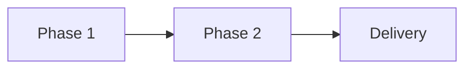

## Summary
[What this epic delivers and why it matters]

## Scope
[The end state once the epic is done — what is in and what is out]

## User stories
- As a [role], I want [capability], so that [benefit].

## Acceptance criteria
- [ ] [verifiable criterion]

## Plan
[How the epic will be delivered: phases, order, and reasoning]

<!-- Optional: remove the diagram if it only repeats a list -->

## Risks
- [risk] — [mitigation]
