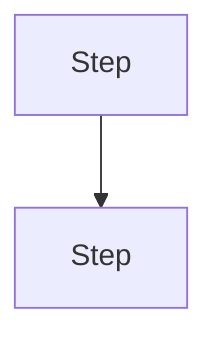

## Objective
[The outcome this goal achieves]

## Scope
[The end state once the goal is reached — what is in and what is out]

## Plan
[What will be done to reach it, in what order, and why]

## Done when
- [ ] [verifiable outcome]
