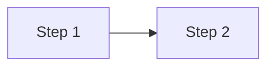

## What will be done
[The concrete action]

## Context
[Why this task is needed]

## Plan
[How it will be tackled and why this approach]

<!-- Optional: remove the diagram if it only repeats a list -->

## Acceptance criteria
- [ ] [criterion]
